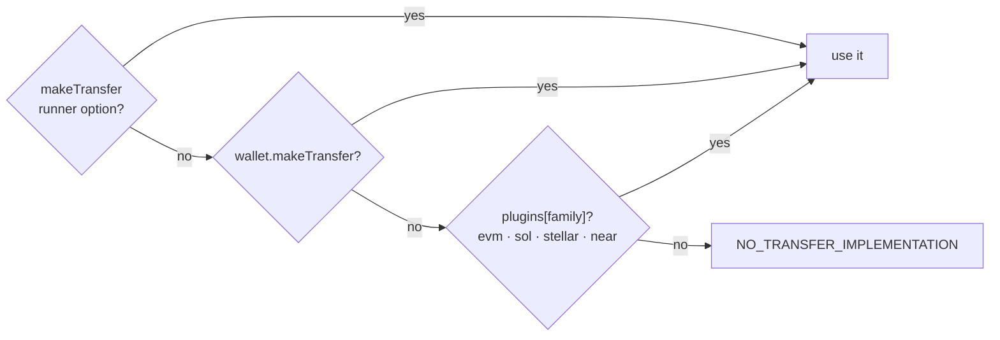

# Wallet integrations

> **Beta.** Part of the [Intents Connect SDK](README.md).

`@aurora-is-near/intents-connect-wallet` gives the [TypeScript SDK](typescript-sdk/README.md) two things:

- **Connect**: a wallet modal and connectors that produce a `WalletConnector` (address, signing standard, providers).
- **Transfer**: `makeTransfer` per chain. It sends the user's deposit to the execution's deposit address.

Every chain SDK is an **optional peer dependency** behind its own subpath, so an EVM-only app never installs Solana or Stellar code.

## Subpaths

| Subpath | Gives you | Install alongside |
|---|---|---|
| `/evm` | `evm` transfer plugin | `viem` |
| `/solana` | `sol` transfer plugin, Solana step helpers | `@solana/web3.js @solana/spl-token` |
| `/stellar` | `stellar` transfer plugin, `decodePublicKey`, `toStellarWalletConnector` | `@stellar/stellar-sdk` |
| `/near` | `near` transfer plugin | none (uses `fetch`) |
| `/connect` | `WalletSelectorModal`, `useWalletSelector`, option presets | `react @headlessui/react` |
| `/connect/appkit` | EVM + Solana connectors (Reown AppKit) | `react viem @reown/appkit @reown/appkit-adapter-ethers @reown/appkit-adapter-solana @solana/wallet-adapter-phantom @solana/wallet-adapter-solflare @solana/web3.js @solana/spl-token` |
| `/connect/near` | NEAR connector (HOT, Meteor, MyNearWallet…) | `react @hot-labs/near-connect` |
| `/connect/stellar` | Stellar connector (Freighter, xBull) | `react @creit.tech/stellar-wallets-kit @stellar/stellar-sdk` |
| `/connect/walletconnect` | Headless WalletConnect: pair an EVM mobile wallet by QR | `@walletconnect/universal-provider` |
| `/detect` | Wallets already connected to the page (EVM, Solana, NEAR), no prompts | none |
| `/detect/react` | `useDetectedWallets()` | `react` |
| `/detect/connector` | `toWalletConnector()` for a detected wallet of any family | `viem @solana/web3.js @solana/spl-token` |
| `/detect/stellar` | `stellarWallets()`: Stellar wallets for detection (Freighter, xBull, LOBSTR, Hana) | `@creit.tech/stellar-wallets-kit @stellar/stellar-sdk` |

Always install `@aurora-is-near/intents-connect` and `@aurora-is-near/intents-connect-wallet`.

## How the runner finds a transfer



A transfer is only needed when `depositViaWallet: true`. With `false`, the user deposits to the shown address from any wallet or exchange.

## Quick path: EVM + Solana

`useIntentsConnectWallet()` returns a `WalletConnector` with the transfer **already wired in**. No plugins needed. This is what the [demo](https://github.com/aurora-is-near/intents-swap-widget/tree/main/apps/intents-connect-demo) uses.

```tsx
import { IntentsConnectProvider } from '@aurora-is-near/intents-connect/react';
import { EVM_SOLANA_WALLET_OPTION, WalletSelectorModal } from '@aurora-is-near/intents-connect-wallet/connect';
import { AppKitProvider, useIntentsConnectWallet } from '@aurora-is-near/intents-connect-wallet/connect/appkit';

function Content() {
  const { wallet, family, connect } = useIntentsConnectWallet(); // family: 'evm' | 'sol' | null

  return <IntentsConnectProvider api={api} wallet={wallet}>…</IntentsConnectProvider>;
}

export const App = () => (
  <AppKitProvider appName="My dApp" themeMode="dark" projectId="YOUR_REOWN_PROJECT_ID">
    <Content />
  </AppKitProvider>
);
```

| `AppKitProvider` prop | Default |
|---|---|
| `projectId` | Aurora's shared Reown id. **Register your own for production** |
| `themeMode` | `'dark'` / `'light'` |
| `rpcOverrides` | publicnode RPCs per EVM chain id |

EVM networks: Ethereum, Arbitrum, Base, BSC, Polygon, Optimism, Avalanche, Gnosis, Berachain, Monad, Plasma, Scroll, X Layer, ADI, Robinhood Chain, Aurora, plus Solana.

## Multi-chain path: EVM, Solana, NEAR, Stellar

Combine connectors with `useWalletSelector`. Only one wallet is connected at a time. These connectors don't carry a transfer, so add **plugins**.

```tsx
import { useWalletSelector, WalletSelectorModal, ALL_WALLET_OPTIONS } from '@aurora-is-near/intents-connect-wallet/connect';
import { useAppKitConnector } from '@aurora-is-near/intents-connect-wallet/connect/appkit';
import { useNearConnector } from '@aurora-is-near/intents-connect-wallet/connect/near';
import { useStellarConnector } from '@aurora-is-near/intents-connect-wallet/connect/stellar';
import { evm } from '@aurora-is-near/intents-connect-wallet/evm';
import { sol } from '@aurora-is-near/intents-connect-wallet/solana';
import { near } from '@aurora-is-near/intents-connect-wallet/near';
import { stellar } from '@aurora-is-near/intents-connect-wallet/stellar';

const nearConnector = useNearConnector();
const selector = useWalletSelector([useAppKitConnector(), nearConnector, useStellarConnector()]);
const providers = selector.providers;

<IntentsConnectProvider
  api={api}
  wallet={toWalletConnector(selector)} // adapter, see the package README
  plugins={{ evm, sol, near, stellar }}
  pluginOptions={{
    evm: { provider: providers.evm },
    sol: { provider: providers.sol },
    near: { wallet: nearConnector.wallet },
    stellar: { provider: providers.stellar },
  }}>
  …
</IntentsConnectProvider>
<WalletSelectorModal
  open={selector.isOpen} onClose={selector.close}
  options={ALL_WALLET_OPTIONS} onSelect={selector.select} />
```

The `toWalletConnector(selector)` adapter is in the [package README](https://github.com/aurora-is-near/intents-swap-widget/tree/main/packages/intents-connect-wallet#connection). Only pass the options whose connector you installed.

## Transfer plugins

Use these when you connect wallets yourself. With a single chain family, `pluginOptions` can be flat. With several, namespace them by family as shown above.

**EVM**
```ts
import { evm } from '@aurora-is-near/intents-connect-wallet/evm';

createExecutionRunner({ api, wallet, plugins: { evm }, pluginOptions: { provider: window.ethereum } });
```
- Switches the chain, or adds it (error 4902 → `wallet_addEthereumChain`).
- Sends native value or an ERC-20 `transfer`.
- On Aurora it uses `withdrawToNear`.

**Solana**: the key is `sol`
```ts
import { sol } from '@aurora-is-near/intents-connect-wallet/solana';

createExecutionRunner({ api, wallet, plugins: { sol }, pluginOptions: { provider, rpcUrl } });
```
- Sends SOL, or an SPL token with `transferChecked`.
- Creates the recipient's token account if it's missing.
- Default RPC is publicnode. Pass `rpcUrl` or `connection` for production.

**NEAR**
```ts
import { near } from '@aurora-is-near/intents-connect-wallet/near';

createExecutionRunner({ api, wallet, plugins: { near }, pluginOptions: { wallet: nearWallet } });
```
- Sends NEAR, or a NEP-141 `ft_transfer`.
- Adds a `storage_deposit` first when needed.
- `nearWallet` needs `signAndSendTransactions`, e.g. `useNearConnector().wallet`.

**Stellar**
```ts
import { stellar } from '@aurora-is-near/intents-connect-wallet/stellar';

createExecutionRunner({ api, wallet, plugins: { stellar }, pluginOptions: { provider } });
```
- Sends XLM, USDC or `CODE:ISSUER` assets, **mainnet only**.
- The deposit **memo is required** (the runner passes it). A deposit without a memo is lost.

## Detected wallets

When your page (or the user's browser) already has a wallet connected, there is no need to show a connect modal: `/detect` finds injected wallets and the accounts they **already share with your site**, without ever prompting.

| Family | How it's found | How the account is read |
|---|---|---|
| EVM | EIP-6963 (`window.ethereum` only if nothing announces) | `eth_accounts`, `eth_chainId` |
| Solana | Wallet Standard (mainnet wallets that can sign) | the wallet's `accounts` |
| NEAR | near-connect injected extension wallets | `getAccounts()` (account and public key) |

```tsx
import { pickConnectedWallet } from '@aurora-is-near/intents-connect-wallet/detect';
import { useDetectedWallets } from '@aurora-is-near/intents-connect-wallet/detect/react';
import { toWalletConnector } from '@aurora-is-near/intents-connect-wallet/detect/connector';

const { ready, wallets } = useDetectedWallets();
const detected = pickConnectedWallet(wallets, ['evm', 'sol', 'near']);

const { connector, unsupportedReason } = detected
  ? toWalletConnector(detected, { sol: { rpcUrl } })
  : { connector: null };

<IntentsConnectProvider api={api} wallet={connector} intentsApi={intentsApi}>…</IntentsConnectProvider>;
```

- The adapters wire each chain's `makeTransfer`, so the connector runs executions as-is. `unsupportedReason` is `NOT_CONNECTED` (no shared account) or `MISSING_PUBLIC_KEY` (NEAR).
- `toWalletConnector` dispatches to the family's adapter and passes it that family's options (`evm`, `sol`, `near`, `stellar`). It needs every family's peers. If you only handle some families, import their adapters directly: `toEvmWalletConnector` (`/evm`), `toSolanaWalletConnector` (`/solana`), `toNearWalletConnector` (`/near`), `toStellarWalletConnector` (`/stellar`).
- `toEvmWalletConnector` omits `getChainId` unless you pass `networkGuard: true`: the network guard runs before the deposit transfer gets a chance to switch the wallet's chain.
- Detection never prompts.
  - It calls a Solana or NEAR wallet only if the user connected it on this site with `connectDetectedWallet` (the one call that prompts; run it from a click).
  - Such a wallet is then restored silently, once per page.
  - Other wallets are listed without an account: some, like HOT and the Solflare Snap, open their UI even when asked to stay silent.
  - The Solana adapter still reconnects silently when it needs to sign.
- `disconnectDetectedWallet` forgets a wallet and asks it to revoke the connection, where it can. `pickConnectedWallet` then skips it.
- NEAR detection only sees injected extension wallets. For sandboxed or in-app wallets use `/connect/near` — `toNearWalletConnector` also accepts `useNearConnector()` state.
- Outside React, `createWalletDetector()` gives `getSnapshot`, `subscribe`, `refresh` and `destroy`. It is SSR-safe.
- Other families plug in through `sources` (on `createWalletDetector` and `useDetectedWallets`), each shipped from its own subpath so `/detect` never pulls its chain SDK. Their wallets carry their own `connect`, `disconnect` and `toConnector`, which the functions above call.
- **Stellar** comes from `/detect/stellar`. Create its source once and pass it in:

  ```tsx
  import { stellarWallets } from '@aurora-is-near/intents-connect-wallet/detect/stellar';

  const sources = [stellarWallets()]; // module scope: the detector is keyed by source ids
  const { wallets } = useDetectedWallets({ sources });
  ```

  - Only installed wallets are listed. Freighter is restored silently; xBull, LOBSTR and Hana ask on every read, so they're restored from the address remembered when the user connected them.
  - Before a signature is submitted, it's checked locally against the account (`isSep53Signature`). A wallet that signed with another account, or not as SEP-53 requires, fails with a named error.
  - Albedo and Rabet aren't included: they can't sign a message.

## Solana step helpers

For [Solana recipes](typescript-sdk/recipes-and-fees.md#solana-steps). They make no network calls and don't sign anything.

```ts
import { createSolanaRecipientAta, prepareSolanaSteps } from '@aurora-is-near/intents-connect-wallet/solana';

const ata = createSolanaRecipientAta({ intermediary, recipient, mint }); // { address, instruction }
return prepareSolanaSteps([ata.instruction, ...swapInstructions], { intermediary, addressLookupTables });
```

## Next

- [TypeScript SDK](typescript-sdk/README.md) · [Examples](examples/README.md)
- [Package README](https://github.com/aurora-is-near/intents-swap-widget/tree/main/packages/intents-connect-wallet) · [npm](https://www.npmjs.com/package/@aurora-is-near/intents-connect-wallet)
