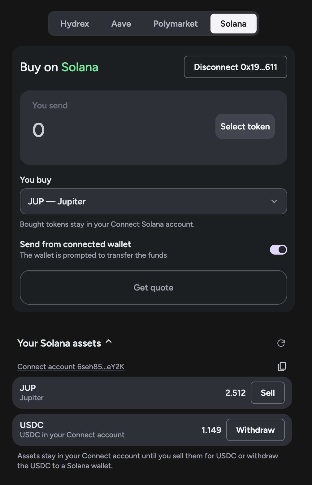

# Reference frontend of Jupiter

This reference frontend demonstrates how to use **Intents Connect** with **Jupiter on Solana** to swap into SPL tokens that are not available as direct destinations through the NEAR Intents 1Click API.

Intents Connect handles cross-chain funding and authorises the operation on the destination chain. Jupiter performs the token swap on Solana through the user's intermediary account.

### Live frontend

<figure><figcaption></figcaption></figure>



[**Open the reference frontend**](https://intents-connect-demo-eight.vercel.app/) and select the **Solana** tab to explore the Jupiter example.

### How it works

1. **Choose a source asset and a Solana token.** The user selects the asset to fund the swap and the SPL token they want to receive.
2. **Prepare the execution.** Intents Connect resolves the user's Solana intermediary account, prepares the Jupiter swap steps, and previews the amount and fees.
3. **Authorize and fund.** The user signs the intent with their source-chain wallet and funds the deposit. The SDK can initiate the transfer from the connected wallet or provide a deposit address.
4. **Execute on Solana.** NEAR Intents moves the funds cross-chain. Once the intermediary account is funded, Intents Connect executes the authorized Jupiter swap on Solana.
5. **Track the result.** The frontend displays execution progress and the final status.

The Solana demo also illustrates **steps-only operations** for selling tokens or withdrawing funds that are already held by the intermediary account, without a new cross-chain deposit.

### Source code

The example frontend is available in the open-source Intents Swap Widget repository:

[**View the Solana frontend source code on GitHub**](https://github.com/aurora-is-near/intents-swap-widget/tree/main/apps/intents-connect-demo/src/solana)

It is built around the [Intents Connect SDK](https://docs.intents.aurora.dev/intents-connect/intents-connect-sdk), which manages signing, deposits, execution status, and destination-chain steps. The Jupiter-specific integration defines the Solana swap operation.

### Related documentation

* [Solana (Jupiter) SDK example](https://docs.intents.aurora.dev/intents-connect/intents-connect-sdk/examples/solana-jupiter) — implementation walkthrough and SDK code.
* [How Intents Connect works](https://docs.intents.aurora.dev/intents-connect/deep-dive/how-it-works) — intent signing, cross-chain funding, and intermediary accounts.
* [Intents Connect SDK](https://docs.intents.aurora.dev/intents-connect/intents-connect-sdk) — packages and integration overview.
* [Solana developer guides](https://docs.intents.aurora.dev/intents-connect/developer-guides/solana) — Solana-specific execution patterns.
